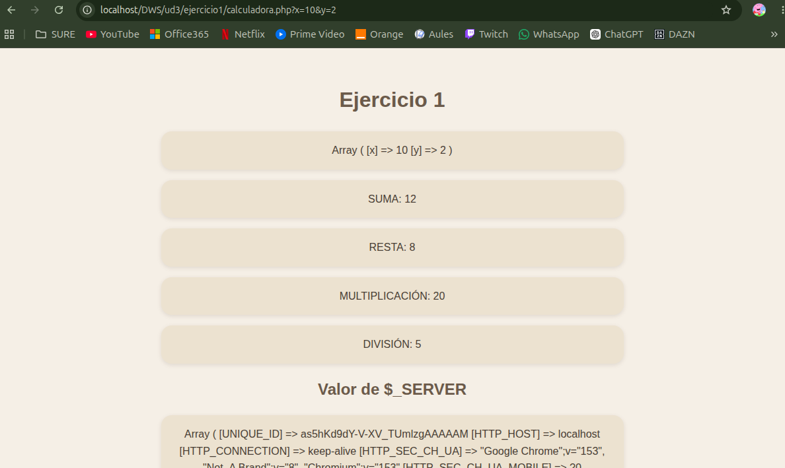

# UNIDAD 3 - EJERCICIO 1

## Enunciado
Escribe un programa calculadora.php que acepte por la dirección las variables $x y $y y
que:
Muestra por pantalla:
• El valor del array $_GET (utiliza la función print_r())
• La suma, resto, multiplicación y división de x e y.
• El valores de la variable $_SERVER.
• ¿Cual es el ordenador que hace la petición?
• En qué variable están los parámetros de la petición.
• ¿Qué es la ruta del sitio web en el ordenador local ?
• Utilitza una vista para mostrar el resultado. calculadora.view.php

## Comprobación

