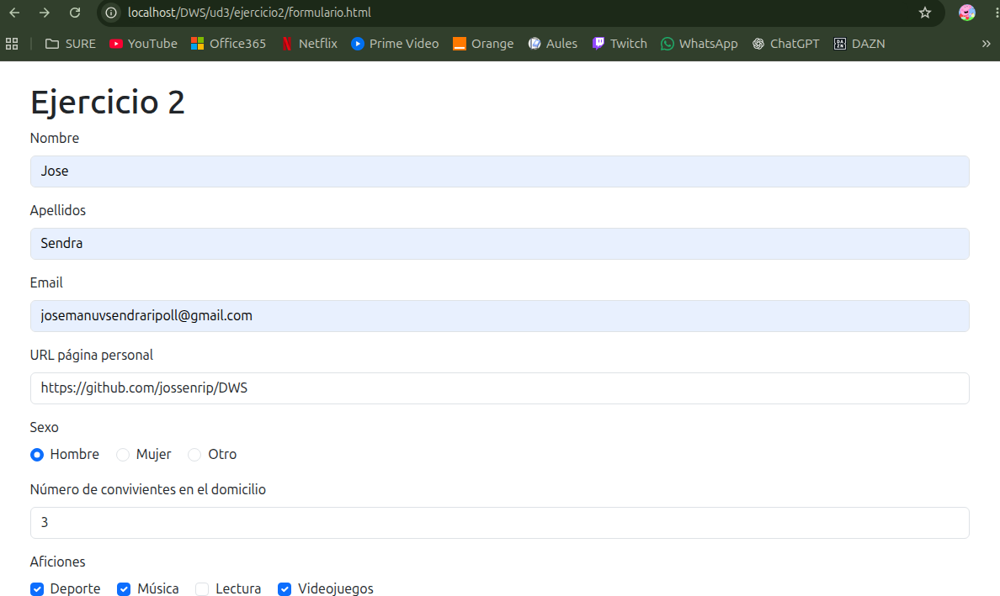
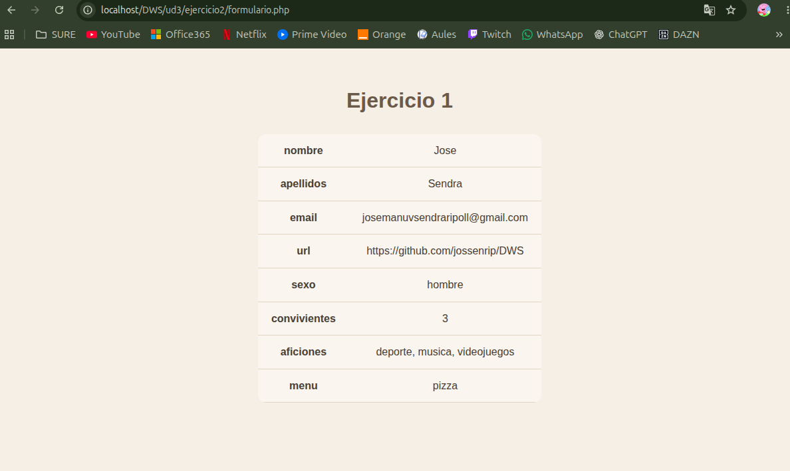

# UNIDAD 3 - EJERCICIO 2

## Enunciado
Crea un formulario(utiliza bootstrap) que solicite:
• Nombre y apellidos.
• Email.
• URL página personal.
• Sexo (radio).
• Número de convivientes en el domicilio.
• Aficiones (checkboxes) => poner mínimo 4 valores.
• Menú favorito (lista selección múltiple) => poner mínimo 4 valores.
• Muestra los valores cargados en una tabla-resumen.

## Comprobación

