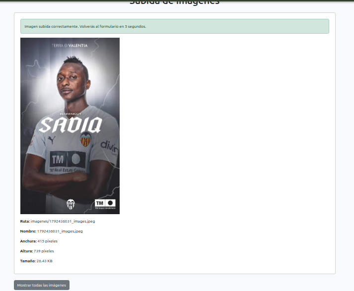
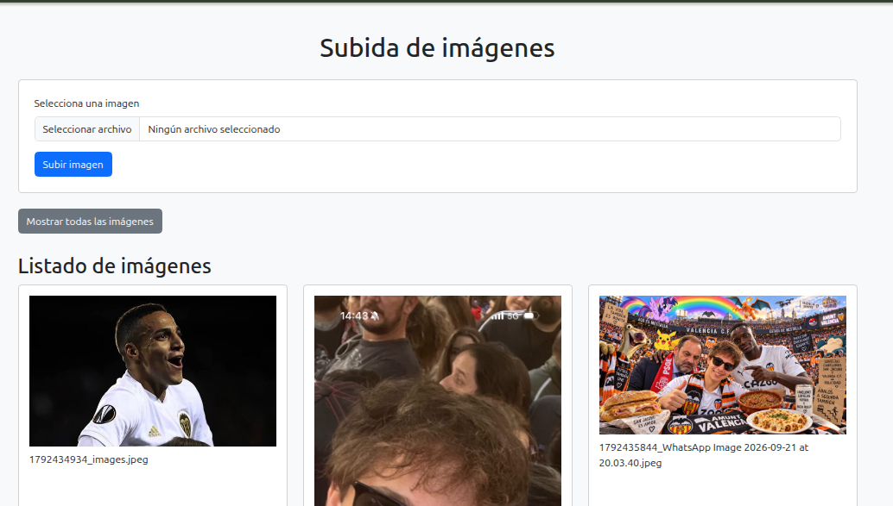

# UNIDAD 3 - EJERCICIO 3

## Enunciado
Crea un formulario que permita subir unicamente imágenes (comprueba la propiedad type del
archivo subido). Si el usuario selecciona otro tipo de archivos, se le debe informar del error y
permitir que suba un nuevo archivo.
En el caso de subir el tipo correcto, visualizar la imagen durante 5 segundos,con la ruta y nombre, tamaño de anchura y altura y redirecciona al formulario. También hay que crear un enlace
para mostrar el listado de todas las imagenes subidas.(analiza/estudia el método scandir()).

## Comprobación

