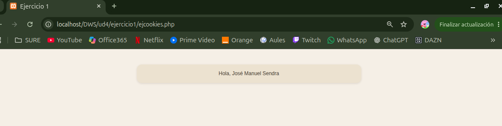

# UNIDAD 4 - EJERCICIO 1

## Enunciado
Realizar una aplicación que compruebe si existe la cookie “user” tiene datos, vuestro
nombre, en caso de estar vacia que la cree con una caducidad de 1000. En la siguiente
ejecución debe de aparecer vuetros nombre en el navegador.
• preferencias.php con un formulario que le pida al usuario su nombre y su color
favorito (a elegir de una lista desplegable, o con el control input type=”color” de
HTML5). El formulario deberá enviarse a guarda_prefs.php.
• guarda_prefs.php que recogerá los datos del formulario anterior, y los guardará
en dos cookies llamadas nombreusu y colorusu, con 5 minutos de duración. Esta
página redirigirá (con header) a la página index.php una vez almacenadas las
cookies.
• index.php que, si hay cookies guardadas del usuario, mostrará una página con el
color de fondo preferido y un mensaje personalizado de bienvenida (por ejemplo,
“Bienvenido, Pepe”). Si no hay cookies guardadas, mostrará una página confondo
blanco y el mensaje “Página de inicio”. En cualquiera de los dos casos, habrá un
enlace para ir al formulario preferencias.php.
• Añade una página borrar_prefs.php que elimine las preferencias (cookies) del
usuario actual, y redirija a index.php. Pon un enlace "Borrar preferencias
" en el index.php que llame a esta página, pero que se muestre sólo cuando el
usuario actual tenga preferencias guardadas.

## Comprobación

