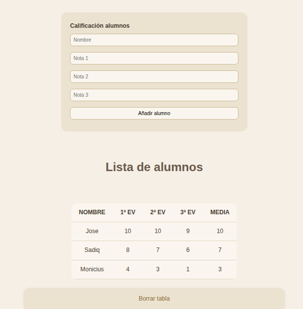

# UNIDAD 4 - EJERCICIO 3

## Enunciado
Crear una pequeña aplicación que permita la gestión académica del módulo de DWES.
Interesa almacenar las notas de cada trimestre y mostrar un informe con las notas la
media y el nombre de los alumnos. Tambiés debe haber un botón/enlace para borrar
los datos.

## Comprobación

