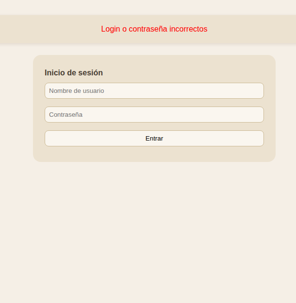
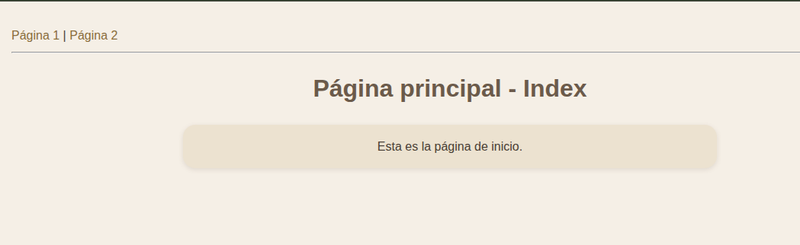
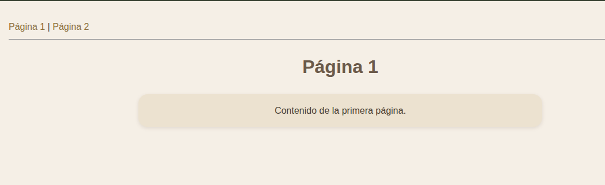

# UNIDAD 4 - EJERCICIO 4

## Enunciado
Crea una carpeta login en la carpeta de ejercicios. Dentro vamos a crear un pequeño
sistema de login y uso de sesiones. Crea los siguientes archivos:
• usuarios.txt donde vamos a guardar varios logins y passwords de prueba, separados por “:”, uno por fila, como en este ejemplo:
usu1:pass1
usu2:pass2
prueba:passprueba
• cabecera.inc que hará lo siguiente:
– Comprobará si existe en sesión un atributo llamado loginusu. Si no existe,
redirigirá a la página login.php que haremos después. Si existe, sacará un
menú de enlaces a las páginas pag1.php y pag2.php
• Crea las páginas index.php, pag1.php y pag2.php que incluyan la cabecera anterior (con require), y como contenido, ponles simplemente un mensaje de bienvenida diferente para cada página (para identificarlas).
• Finalmente, la página de login.php tendrá un formulario para pedirle al usuario
su login y password, y se llamará a sí misma. Los datos que reciba del formulario,
los comparará con los del fichero usuarios.txt para ver si coincide con alguno. Si
coincide, creará un atributo loginusu en sesión con el login del usuario y redirigirá
a index.php. Si no coincide con ninguno, se volverá a cargar el propio formulario,
con un mensaje de error en rojo indicando que el login o la contraseña son incorrectos.

## Comprobación

