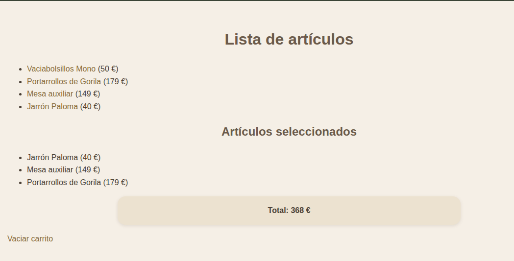

# UNIDAD 4 - EJERCICIO 4

## Enunciado
Crea una carpeta llamada carro con una página llamada carro.php con una lista de
enlaces de diferentes artículos y su precio. Por ejemplo:
Zapatillas Nike (60 euros)
Sudadera Domyos (15 euros)
Pala de pádel Vairo (50 euros)
Pelota de baloncesto Molten (20 euros)
Puedes alimentar la lista desde un array de artículos previamente definido en PHP,
como este:
$articulos = array(
array("id" => 1, "nombre" => "Zapatillas Nike", "precio" => 60),
array("id" => 2, "nombre" => "Sudadera Domyos", "precio" => 15),
array("id" => 3, "nombre" => "Pala de pádel Vairo", "precio" =>
50),
array("id" => 4, "nombre" => "Pelota de baloncesto Molten", "
precio"
=> 20)
);
Cada vez que el usuario haga clic en un artículo, se enviará a la propia página, recogerá el
código o id del artículo (que se le enviará como parámetro) y con ello buscará el artículo
en el catálogo y acumulará en sesión el total de lo que ha ido comprando, junto con
un listado de los artículos que ha seleccionado, para mostrarlo todo por pantalla.

## Comprobación

